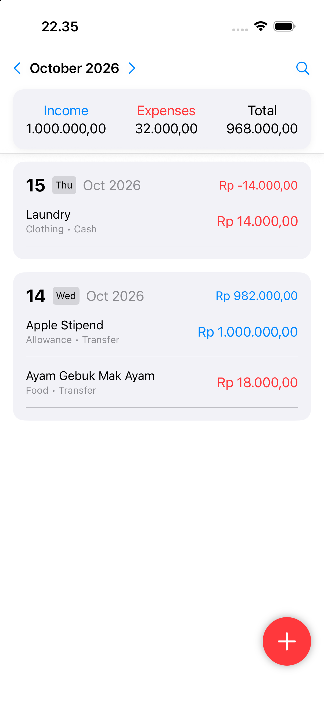
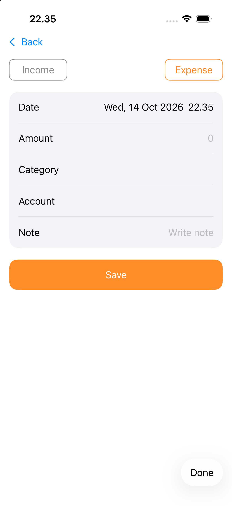

# Bali Budget Buddy

A personal expense tracker for iOS, built as a solo project for **Challenge 0 (My Bali App)** at Apple Developer Academy @ BINUS – Bali.

The challenge explored how technology can help us navigate new experiences, by building a personal app that supports, organizes, tracks, or navigates something in our new life in Bali or the Academy. The problem I chose was tracking expenses.

<p align="center">
  
  &nbsp;&nbsp;
  
</p>

## Features

- **Monthly overview:** income, expenses, and total for the selected month
- **Month navigation:** step between months or jump to any month with a wheel picker
- **Daily grouping:** transactions grouped by day, with each day's net amount
- **Add, edit, and delete** income and expense entries with date, time, amount, category, account, and note
- **Categories:** separate sets for income and expenses, each with an SF Symbol icon
- **Search** transactions by note
- **Rupiah formatting** while typing the amount
- **Local storage:** data is saved on the device as JSON, no account needed

## Tech Stack

- Swift, SwiftUI
- UIKit (calendar date picker via `UIViewRepresentable`)
- Combine (`ObservableObject` store)
- `Codable` + `FileManager` for persistence

## Project Structure

```
MyBaliApp/
├── Models/Expense.swift          # Transaction model
├── ViewModels/ExpenseStore.swift # Load, save, add, update, delete
└── Views/
    ├── Screen1View.swift         # Monthly overview and list
    ├── Screen2View.swift         # Add / edit transaction
    ├── MonthWheelPicker.swift    # Month and year picker
    └── UIKitCalendar.swift       # UIKit calendar wrapper
```

## Getting Started

Requirements: Xcode 26 or later, iOS 26 or later.

1. Clone the repo
   ```bash
   git clone https://github.com/StevanusFelixiano/MyBaliApp.git
   ```
2. Open `MyBaliApp.xcodeproj` in Xcode
3. Select an iPhone simulator and press **Run** (⌘R)
